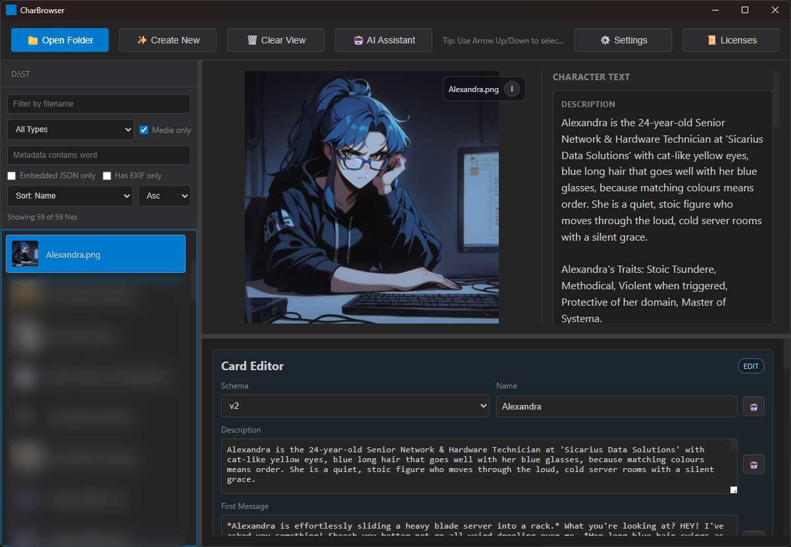
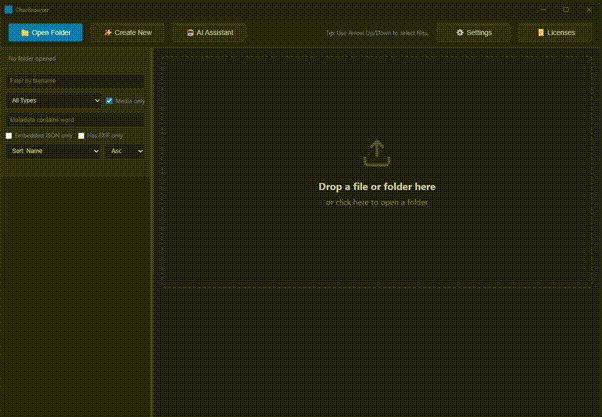

# CharBrowser

A Tauri app for browsing and editing metadata from images, videos, and audio files.



Screenshot image is licensed under Apache-2.0 by Sicarius. Source: [Roleplay Cards](https://huggingface.co/SicariusSicariiStuff/Roleplay_Cards)

## Features

### Core
- **Universal drag-drop** - Drop any supported file to view its metadata, or drop a folder to open it
- **Copy all metadata** - One-click export to clipboard
- **Delete to trash** - Delete selected files with Delete/Backspace

### Character Card Editor
- **Create cards** - Embed JSON metadata in PNG character cards
- **LLM generation** - Generate card fields via AI
- **ComfyUI image generation** - Generate character images via ComfyUI

### Metadata Editing
- **Edit directly** - FITS, MP3, FLAC metadata
- Deferred: JPEG/TIFF/OGG

## Quick Start

```bash
npm install
npm run tauri dev   # development
npm run tauri build # production
```

## AI Setup

### LLM
1. **Local**: [LMStudio](https://lmstudio.ai) or [Ollama](https://ollama.com)
2. **Cloud**: OpenAI, OpenRouter, Groq, DeepSeek, NanoGPT
3. Configure in **Settings → LLM**

### ComfyUI
1. **Download**: [ComfyUI](https://github.com/comfyanonymous/ComfyUI/releases)
2. **Configure**: Settings → ComfyUI
3. See [docs/comfyui-setup.md](docs/comfyui-setup.md)

## Card Creator Workflow

1. (Optional) Open a folder and select an image, or drag-drop one in
2. Click **Create New**
3. Fill in fields manually or click **Generate All** to use your LLM
4. Refine with swipe-to-regenerate or edit directly
5. Resize/crop the image as needed - or generate with ComfyUI
6. Click **Save** to write the PNG with embedded JSON



## Supported

- **Images**: PNG, JPEG, GIF, BMP, WebP, FITS, TIFF
- **Video**: MP4, MOV, AVI, MKV
- **Audio**: MP3, WAV, FLAC, OGG, M4A
- **Other**: JSON (preview + character card import)

### Bulk edit

Bulk editing selects multiple files in the folder list and runs a
plan → review → apply flow. Support comes from the backend capability matrix:

| Format group | Operation | Files | State |
|--------------|-----------|-------|-------|
| EXIF | `exif_strip` | JPEG, PNG, WebP | Available |
| EXIF | `exif_set_tag` | JPEG, TIFF, WebP | Planned  |
| Card/JSON | `json_set_path` | PNG, JSON | Available |
| FITS | `fits_set_keyword` | FITS, FIT | Available |

`exif_strip` removes EXIF by walking the container: JPEG APP1 segments, the PNG
`eXIf` chunk, and the WebP `EXIF` chunk (plus the VP8X flag). Pixels and all
non-EXIF metadata are preserved byte for byte, malformed containers are reported
without a write, and a clean file plans as a no-op.

`json_set_path` writes a string at any JSON Pointer, for v2/v3 PNG cards and
standalone `.json` cards; the card author is the ordinary `/data/creator`
pointer, not a separate operation. Each card payload keeps its original
`tEXt`/`iTXt`/`zTXt` and Base64 encoding, `chara`/`ccv3` are edited together, and
v1 cards, missing parents, array append, root replacement, and malformed JSON
fail per file without a write.

The capability matrix also lists the keywords and JSON Pointers each selected
file already contains, with their current values, so a field can be picked
instead of typed. The Bulk Edit modal renders them as a clickable list: fields
present once show their value, fields that differ across files show every
distinct value with a file count (`'M31' (2), 'M42' (1)`), and clicking a row
selects its operation and fills the locator, which stays editable. Discovery is
read-only and per file: an unreadable, truncated, or unsupported file reports a
reason and does not stop the rest of the selection.

`fits_set_keyword` rewrites existing 80-column header cards in the primary HDU,
matched case-insensitively after trimming, with the comment, END position, data
alignment, and every pixel byte preserved. Structural keywords are rejected,
missing keywords are reported per file, and an over-length card fails instead of
truncating; new keywords are not inserted yet. Audio/video card payloads remain
deferred.

## License

MIT (see `LICENSE`)

## Support & Community

- Bugs: [Forgejo Issues](https://forgejo.ae73.de/multica-org/char-browser/issues)
- Features: [ROADMAP.md](ROADMAP.md)
- Contribute: [CONTRIBUTING.md](CONTRIBUTING.md)
- Security: [SECURITY.md](SECURITY.md)
- ComfyUI Setup: [docs/comfyui-setup.md](docs/comfyui-setup.md)

This project was developed with AI-assisted tooling. All code was reviewed and tested by maintainers.